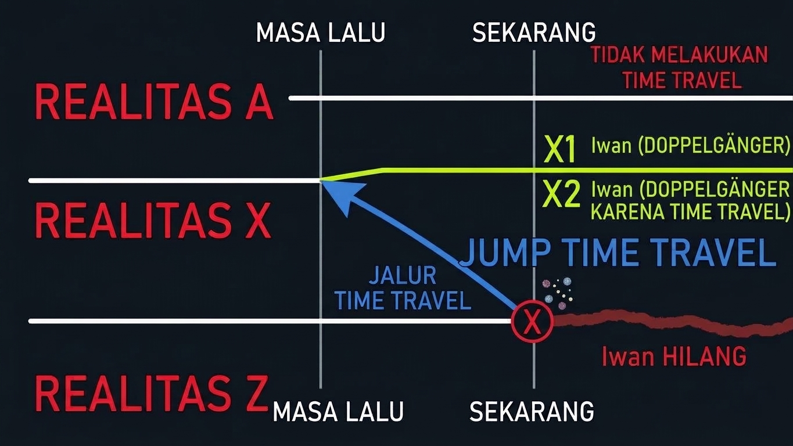

# 🌌 Many-World Interpretation Time Travel Simulation

Repositori ini berisi skrip Bash sederhana (`manyWorld.sh`) yang mensimulasikan konsep **Many-World Interpretation (Interpretasi Banyak Dunia)** dalam skenario perjalanan waktu (Time Travel). Simulasi ini menggambarkan bagaimana satu tindakan perjalanan waktu dapat menciptakan percabangan realitas, menghasilkan *Doppelgänger* (kembaran), dan menghilangkan entitas asli dari garis waktu asalnya.

Proyek ini terinspirasi dari diagram alur visual yang memetakan tiga kemungkinan realitas (Realitas A, X, dan Z).

---

## 📖 Latar Belakang Konsep

Bayangkan skenario berikut:
1.  **Kemarin:** Seorang pria bernama Iwan menaiki bus. Total penumpang di dalam bus adalah **20 orang** (termasuk Iwan).
2.  **Hari Ini (Sekarang):** Iwan melakukan perjalanan waktu (Time Travel) kembali ke masa lalu, tepat saat dia menaiki bus tersebut.
3.  **Aksi:** Iwan dari masa depan tiba di dalam bus dan bertemu dengan dirinya sendiri di masa lalu.

### Analisis Tiga Realitas

Berdasarkan simulasi dan diagram, terdapat tiga garis waktu yang terbentuk:

*   🔴 **REALITAS A (Tanpa Time Travel)**
    *   Garis waktu ini berjalan normal.
    *   Iwan tidak melakukan perjalanan waktu.
    *   Tidak ada perubahan. Jumlah penumpang tetap 20 orang, dan hanya ada 1 Iwan.
    *   *Status: Aman, tidak berubah.*

*   🔴 **REALITAS Z (Garis Waktu Asal - Tempat Iwan Hilang)**
    *   Ini adalah garis waktu di mana Iwan memutuskan untuk melakukan perjalanan waktu.
    *   Karena Iwan "melompat" keluar dari waktu ini, keberadaannya di masa kini **hilang (Iwan HILANG)**.
    *   Garis waktu ini menjadi "rusak" atau berakhir untuk Iwan (ditandai dengan garis merah bergelombang pada diagram).
    *   *Status: Iwan menghilang dari realitas ini.*

*   🟢 **REALITAS X (Garis Waktu Baru - Tempat Doppelgänger Muncul)**
    *   Ini adalah realitas baru yang terbentuk akibat lompatan waktu.
    *   Iwan dari masa depan (X1) tiba di masa lalu dan bertemu dengan Iwan masa lalu (X2).
    *   Terjadi pertemuan antara dua entitas Iwan.
    *   Jumlah penumpang bus di realitas ini bertambah menjadi **21 orang** (20 orang asli + 1 Iwan dari masa depan).
    *   *Status: Terdapat 2 Iwan (Doppelgänger).*

---

## 📊 Diagram Alur


```text
       MASA LALU             SEKARANG
         |                     |
REALITAS A --------------------+-------> (TIDAK MELAKUKAN TIME TRAVEL)
         |                     |
         |                     |         X1 Iwan (DOPPELGÄNGER)
REALITAS X --------------------+========> (Iwan MASUK KE BUS)
         |                  /  |         X2 Iwan (DOPPELGÄNGER KARENA TIME TRAVEL)
         |            JUMP   /   |
         |          TIME    /    |
         |        TRAVEL   /     |
REALITAS Z ----------------X------X----> (Iwan HILANG)
         |                     |
